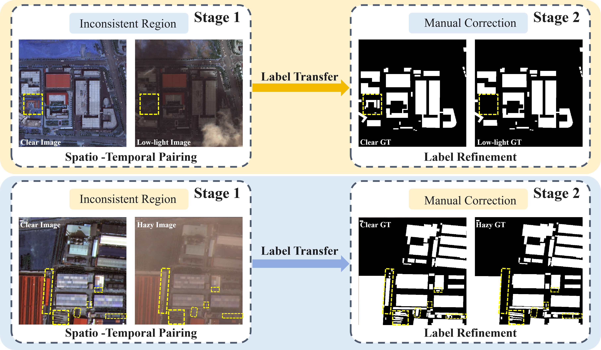

# Building Extraction from Remote Sensing Imagery under Adverse Weather: Benchmark and Baseline

This is the official implementation of the paper: 
> **Building Extraction from Remote Sensing Imagery under Adverse Weather: Benchmark and Baseline**
>
> *Feifei Sang†, Wei Lu†, Hongruixuan Chen, Si-Bao Chen∗, Jin Tanga and Bin Luoa* 

----

 

  Illustration of the annotation pipeline for the HaLoBuilding dataset based on the Same-Scene Multitemporal Pairing strategy. The process consists of two stages: Stage 1 pairs clear reference images with adverse-weather counterparts. Stage 2 transfers high-quality labels from clear images, followed by rigorous manual refinement. The yellow dashed boxes highlight inconsistent regions caused by temporal gaps or visibility degradation, which are manually corrected to ensure high-fidelity, pixel-level alignment with the actually visible buildings.

 

----

  

  Abstract
  

Building extraction from optical remote sensing (RS) imagery suffers from performance degradation under real-world hazy and low-light conditions. Although SAR provides complementary all-weather observations, many existing methods and benchmarks are developed for widely available optical RGB imagery and primarily focus on clear-weather conditions. To address this gap, we introduce HaLoBuilding, the first optical benchmark specifically designed for building extraction under hazy and low-light conditions. A same-scene multitemporal pairing strategy, followed by manual inspection and refinement, improves pixel-level annotation alignment under severe degradation. Building upon this benchmark, we propose HaLoBuild-Net, an end-to-end framework for building extraction in adverse RS scenarios. At its core, the Spatial-Frequency Focus Module (SFFM) combines large-receptive-field spatial attention for contour refinement with frequency-aware channel reweighting guided by relatively stable low-frequency statistics. Additionally, a Global Multi-scale Guidance Module (GMGM) provides global semantic constraints to anchor building topologies, while a Mutual-Guided Fusion Module (MGFM) implements bidirectional semantic-spatial calibration to suppress shallow noise and sharpen weather-induced blurred boundaries. Extensive experiments show that HaLoBuild-Net achieves higher IoU and F1 scores than the evaluated state-of-the-art methods and restoration-segmentation cascades on HaLoBuilding, while remaining competitive on the WHU, INRIA, and LoveDA datasets.

## Installation
+ Prerequisites for Python:
  - Creating a virtual environment in the terminal: `conda create -n HaLoBuild python=3.10`
  - Activate the environment: `conda activate HaLoBuild`
  - Installing necessary packages: `pip install -r requirements.txt`

+ Train/Test
  - `python train.py`
  - `python test.py`
  
## Pre-train Backbone Weights on Imagenet-1k

Imagenet 300-epoch pre-trained LWGANet-L2 backbone: [Download](https://github.com/lwCVer/LWGANet/releases/download/weights/lwganet_l2_e296.pth)

## Introduction

The code will be available.

The dataset can be downloaded at [Baidu netdisk](https://pan.baidu.com/s/1MDS15v0zWMHhTf9mAnZxrw?pwd=0220)(Password:0220) or [Google Drive](https://drive.google.com/drive/folders/1ikmg7jdjC-yGk70mxTspxxMa4HLLmonC?usp=drive_link).

If you have any questions about this work, you can contact me. 

Email: [luwei_ahu@qq.com](mailto:luwei_ahu@qq.com); WeChat: luwei_ahu.

Your star is the power that keeps us updating github.

## License
Licensed under a [Creative Commons Attribution-NonCommercial 4.0 International](https://creativecommons.org/licenses/by-nc/4.0/) for Non-commercial use only.
Any commercial use should get formal permission first.
